<p align="center">
  
</p>

<p align="center">
  <a href="https://haidaresber.github.io"></a>
  <a href="https://www.linkedin.com/in/haidaresber"></a>
  <a href="https://doi.org/10.5281/zenodo.19047475"></a>
  <a href="https://www.npmjs.com/package/ecobrowser"></a>
</p>

<p align="center"></p>

## Player card

|  |  |
|---|---|
| 🎮 **Class** | Fullstack developer · security and AI researcher |
| 🏢 **Now** | Fullstack developer at **Eona-X** · Paris |
| 🏫 **Guild** | **EFREI Paris** (software architecture / AI), with Panthéon-Assas Université |
| 🛠️ **Founder** | **[CoJeCo](https://cojeco.fr)**, a digital-inclusion non-profit |
| 🔬 **Research** | 2 open-access papers: WiFi privacy ([PhaseShield](https://doi.org/10.5281/zenodo.19047475)) and AI-generated propaganda |
| 🗣️ **Languages** | Arabic (native) · French (C2) · English (C2) |
| 🌍 **Base** | Paris, France · born in Lebanon 🇱🇧 |
| 🧭 **Direction** | Security, AI, and tech governance, with a long-term interest in the Middle East and Lebanon |

> 💾 **SAVE-DATA NOTICE.** Most of my repositories are **private** (client work, coursework, infrastructure and security labs). This profile is a small, curated selection of what I can share publicly. I'm happy to walk through private work in a conversation.

<h2 align="center">MAIN MENU</h2>

<table align="center">
  <tr><td>▶ <a href="#quest-log"><b>QUEST LOG</b></a></td><td>projects I've built (click to expand)</td></tr>
  <tr><td>▶ <a href="#research-lab"><b>RESEARCH LAB</b></a></td><td>published papers</td></tr>
  <tr><td>▶ <a href="#career-log"><b>CAREER LOG</b></a></td><td>experience and education</td></tr>
  <tr><td>▶ <a href="#guild-hall"><b>GUILD HALL</b></a></td><td>community and non-profit work</td></tr>
  <tr><td>▶ <a href="#trophies"><b>TROPHIES</b></a></td><td>certifications</td></tr>
  <tr><td>▶ <a href="#inventory"><b>INVENTORY</b></a></td><td>the stack I work with</td></tr>
  <tr><td>▶ <a href="#locked-chest"><b>LOCKED CHEST</b></a></td><td>what's in my private repos</td></tr>
  <tr><td>▶ <a href="#continue"><b>CONTINUE?</b></a></td><td>how to reach me</td></tr>
</table>

<p align="center"></p>

## Quest log

<sub>Click a quest to expand it. Every quest links to the real repository.</sub>

<details>
<summary>🛒 <b>QUEST 1: nuage-commerce</b> &nbsp;·&nbsp; <i>full-stack e-commerce, live in production</i></summary>

<br>

A French-language store for premium chichas, with a storefront, an admin back office and a pipeline that sources products automatically.

- **Storefront and checkout:** Next.js 16, React 19, TypeScript, Supabase, Stripe
- **Automated sourcing:** scraping, AI curation, review translation and image processing, run by scheduled cron jobs
- **Also:** MDX blog, AI support chatbot, analytics, transactional email, PWA, 435 commits, Vitest tests

🔗 [Repository](https://github.com/HaidarESBER/nuage-commerce) · 🌐 [Live shop](https://chichanuage.com)

</details>

<details>
<summary>🤖 <b>QUEST 2: ai-browser</b> &nbsp;·&nbsp; <i>published on npm as <code>ecobrowser</code></i></summary>

<br>

An AI-native browser framework, "the AI's hands and eyes on the web", shipped as a TypeScript library **and** an MCP server.

- **Structured, no-pixel perception** of pages, with incremental diffs and a live view
- **Verified, self-healing actions:** every action checks its own result, and retries are guarded
- **MCP server with 22 tools** you can add to Claude Code in one line

```bash
npm install ecobrowser
claude mcp add ecobrowser -- npx -y ecobrowser-mcp
```

[](https://www.npmjs.com/package/ecobrowser) [](https://www.npmjs.com/package/ecobrowser)

📦 [**ecobrowser on npm**](https://www.npmjs.com/package/ecobrowser) · 🔗 [Repository](https://github.com/HaidarESBER/ai-browser)

</details>

<details>
<summary>🔍 <b>QUEST 3: privasearch</b> &nbsp;·&nbsp; <i>private AI search, fully self-hosted</i></summary>

<br>

Search that stays on your machine: SearXNG for results, Ollama for the model, and RAG so every answer is **cited**.

- **Stack:** React, Node.js, Docker Compose, SearXNG, Ollama
- **Flow:** results stream in first, then the cited answer streams after them
- **Why:** private by design: a local model, self-hosted search and no third-party AI API

🔗 [Repository](https://github.com/HaidarESBER/privasearch)

</details>

<details>
<summary>🎨 <b>QUEST 4: privasvg</b> &nbsp;·&nbsp; <i>Rust → WebAssembly, 100% in the browser</i></summary>

<br>

Turns raster images into clean SVG without uploading anything.

- **Pipeline:** AI background removal → manual retouch → 2x/4x upscale → vectorize (Rust compiled to WebAssembly)
- **Bulk mode:** convert up to 50 images into one ZIP
- **Privacy:** everything runs client-side

🔗 [Repository](https://github.com/HaidarESBER/privasvg) · 🌐 [Live demo](https://haidaresber.github.io/privasvg/)

</details>

<details>
<summary>📱 <b>QUEST 5: claude-whatsapp-notify</b> &nbsp;·&nbsp; <i>drive Claude Code from your phone</i></summary>

<br>

Approve or deny commands, send prompts and talk to your open Claude Code sessions from WhatsApp.

- **Remote approvals, live sessions, images, files and voice notes** (transcribed locally with Whisper)
- **Guest mode** for group chats: a locked-down Claude with web search only
- **Security model documented:** authenticated local API, rate-limited pairing, and approvals that refuse to hide a long command's tail

🔗 [Repository](https://github.com/HaidarESBER/claude-whatsapp-notify)

</details>

<details>
<summary>📰 <b>QUEST 6: majalpost</b> &nbsp;·&nbsp; <i>Arabic-first, right-to-left news platform</i></summary>

<br>

A news and media platform for Lebanese affairs, built RTL-first.

- **Monorepo:** Next.js frontend, Express/MongoDB REST API, shared TypeScript types
- **Features:** admin dashboard, roles (admin, editor, contributor, user), media uploads, comments, contributor applications
- **CI** on every push

🔗 [Repository](https://github.com/HaidarESBER/majalpost) · 🌐 [Live site](https://majalpost.vercel.app)

</details>

<details>
<summary>🎵 <b>QUEST 7: nowplaying</b> &nbsp;·&nbsp; <i>an always-on screen for what you're listening to</i></summary>

<br>

A Spotify "now playing" display with synced lyrics, installable as a PWA on iPhone and Android. Vanilla JavaScript, no dependencies, with a demo mode that plays sample songs.

🔗 [Repository](https://github.com/HaidarESBER/nowplaying) · 🌐 [Live demo](https://haidaresber.github.io/nowplaying/)

</details>

**Side quests:** 🏋️ [sports](https://github.com/HaidarESBER/sports) (community workout planner, Next.js) · 🔬 [microscope-3d-render](https://github.com/HaidarESBER/microscope-3d-render) ([demo](https://haidaresber.github.io/microscope-3d-render/)) · 🏠 [3D room portfolio](https://haidaresber.github.io) ([source](https://github.com/HaidarESBER/haidaresber.github.io))

<p align="center"></p>

## Research lab

<sub>Both papers are open access (CC BY 4.0).</sub>

<details>
<summary>📡 <b>PhaseShield</b> &nbsp;·&nbsp; <i>published March 2026 on Zenodo and HAL</i></summary>

<br>

**Adversarial perturbation of WiFi Channel State Information to mitigate passive sensing.**

Anyone with a laptop or a €15 ESP32 can passively track movement, breathing and heart rate through walls by reading a home's WiFi signals, with no network access. PhaseShield is a framework that perturbs the CSI to defeat that surveillance. It exploits an asymmetry: legitimate OFDM receivers correct phase rotations automatically, while a passive CSI sniffer can't tell the difference.

- **Results (simulation):** detection confidence drops from 0.72–0.89 to below 0.15, with no loss in network throughput (proven for ε ≤ π/4 rad)
- **Efficiency:** 15% of subcarriers are enough for 60% of the disruption
- **Next step:** hardware validation on ESP32

📄 [Zenodo (DOI)](https://doi.org/10.5281/zenodo.19047475) · 📄 [HAL](https://hal.science/hal-05553940) · 📄 [ResearchGate](https://www.researchgate.net/profile/Haidar-Esber)

</details>

<details>
<summary>🛡️ <b>AI-generated propaganda</b> &nbsp;·&nbsp; <i>preprint: why today's countermeasures fall short</i></summary>

<br>

A comparison of the most-cited defences against AI-generated propaganda (watermarking, the C2PA provenance standard, deepfake detectors and "prebunking") judged by the same criteria, separating failures built into their design from ones better engineering could fix.

- **Central finding:** these tools authenticate content one item at a time, but AI's impact on propaganda sits elsewhere, in the **cost, volume and coordination** of campaigns and in **conversational persuasion**, where there is no file to authenticate
- **Proposal:** a layered defence architecture for three levels of adversary, with recommendations for AI developers, platforms, regulators and researchers
- **Context:** it continues the line of work started with PhaseShield: defences against threats that technology has made cheap

Open access on Zenodo and HAL. Feedback is welcome, especially from researchers in disinformation, trust & safety and AI governance.

</details>

## Career log

<details>
<summary>💼 <b>Experience</b> &nbsp;<sub>(click to expand)</sub></summary>

<br>

| When | Role | Where |
|---|---|---|
| Now | **Fullstack developer** | Eona-X · Paris |
| Jun 2025 → now | **Founder, trainer and developer** | [CoJeCo](https://cojeco.fr), a digital-education non-profit |
| Sep 2025 → now | **Fullstack and no-code developer** | B2B marketplace for lab equipment: migration from Bubble.io to React / Next.js / Node.js, a reference-import tool (image/PDF parsing), CDN fixes |
| 2025 → now | **AI transformation consultant** | Law firm: a 12-month, four-phase AI roadmap with deliverables tracked in Notion |
| Dec 2024 → now | **Fullstack developer** | Ethical AI search engine: SearXNG and DuckDuckGo integration, scraping, LLM summarisation, chatbot |
| Sep 2024 → Sep 2025 | **Application developer and IT support** | Pôle BTS Alternance, Trélazé: internal web apps, partner tooling, automation scripts, Azure licence and mail management |
| Nov 2019 → May 2020 | **Arduino tutor** | Lebanese Organization for Studies and Technology: robotics for young students |

</details>

<details>
<summary>🎓 <b>Education</b> &nbsp;<sub>(click to expand)</sub></summary>

<br>

| When | Programme | School |
|---|---|---|
| Sep 2026 → | MSc-level: Software Architecture / AI Expert | EFREI Paris |
| 2025 → 2026 | BSc-level: Fullstack Developer | EFREI Paris |
| 2025 | Learning AI Through Visualization | Columbia University |
| 2024 → 2025 | Application Design and Development | LearnIT / Pôle BTS Trélazé |
| 2023 → 2024 | L1 Mathematics and Computer Science | Université d'Angers |

</details>

## Guild hall

<details>
<summary>🤝 <b>Community and non-profit work</b></summary>

<br>

- **[CoJeCo](https://cojeco.fr) (Collectif de Jeunes Connectés):** I founded this non-profit to fight digital exclusion with free, accessible training. It delivers Cisco Networking Academy courses and works with partners including Cisco, Microsoft, LPI and Palo Alto Networks. I built the website, run the tech workshops and coordinate the volunteers.
- **VivaTech Paris:** volunteer **team captain** at the parc des expositions: thousands of visitors, AI everywhere, and the job of keeping the floor running.
- **Teaching:** Arduino robotics tutor for young students in Lebanon (2019–2020).
- **Beyond code:** an aeronautics initiation certificate (BIA), RF and electronics tinkering, a home network lab (Zabbix, OpenVPN, Active Directory) and a Rubik's cube habit.

</details>

<p align="center"></p>

## Trophies

<details>
<summary>🏆 <b>20+ certifications</b> &nbsp;<sub>(click to expand)</sub></summary>

<br>

- **Cisco Networking Academy:** Ethical Hacker · Introduction to Cybersecurity · Introduction to Modern AI · Introduction to Data Science · Python Essentials · JavaScript Essentials · IT Essentials · and more
- **NASA Open Science:** Open Science Essentials · Science 101
- **Cloud and AI:** AWS Educate (Introduction to Generative AI) · Columbia University (Learning AI Through Visualization)
- **Hardware:** Arduino UNO Robotics
- **Languages:** EF SET English C2 · DELF B2 (French)
- **Business:** LVMH (Creation & Branding, Retail & Customer Experience)

</details>

## Inventory

|  | Items |
|---|---|
| ⚔️ **Languages** | TypeScript · JavaScript · Python · PHP · Rust · SQL · Bash |
| 🛡️ **Frontend** | React · Next.js · Vite · Tailwind |
| 🧪 **Backend** | Node.js · Express · Symfony · REST |
| 🧠 **AI and data** | Ollama · LLM pipelines · RAG · Whisper · MCP · SearXNG · n8n |
| ☁️ **Cloud and ops** | Azure · Docker · Terraform · GitHub Actions · Linux |
| 🌐 **Network** | Active Directory · Zabbix · OpenVPN |
| 🔌 **Embedded** | ESP32-S3 · Arduino |
| 🗃️ **Data** | Supabase · MongoDB · PostgreSQL |

## Locked chest

<details>
<summary>🔒 <b>Open to see what's in my private repositories</b></summary>

<br>

Most of my work isn't public. The private repos contain:

- **Cloud infrastructure** on Azure with Terraform
- **Docker CI/CD pipelines** with PostgreSQL
- **Python** tooling: job-search automation and federated-learning research
- **A Symfony application-security lab**, plus a deliberately vulnerable app for training
- **Websites and web apps built for clients**
- Coursework and group projects from EFREI

Want to see any of it? Ask and I'll walk you through it.

</details>

## Continue?

<details>
<summary>🎮 <b>Enter the cheat code</b> &nbsp;<sub>(↑ ↑ ↓ ↓ ← → ← → B A)</sub></summary>

<br>

Cheat code accepted. Here is how to reach me:

- 🌐 Portfolio: [haidaresber.github.io](https://haidaresber.github.io)
- 💼 LinkedIn: [in/haidaresber](https://www.linkedin.com/in/haidaresber)
- 🔬 Research: [ResearchGate](https://www.researchgate.net/profile/Haidar-Esber) · [Zenodo](https://doi.org/10.5281/zenodo.19047475)
- 💻 GitHub: [@HaidarESBER](https://github.com/HaidarESBER)

</details>

<p align="center"></p>

<p align="center"><sub>▶ PLAYER 1 · EFREI PARIS · <a href="https://github.com/HaidarESBER?tab=repositories">browse all public repositories</a></sub></p>
